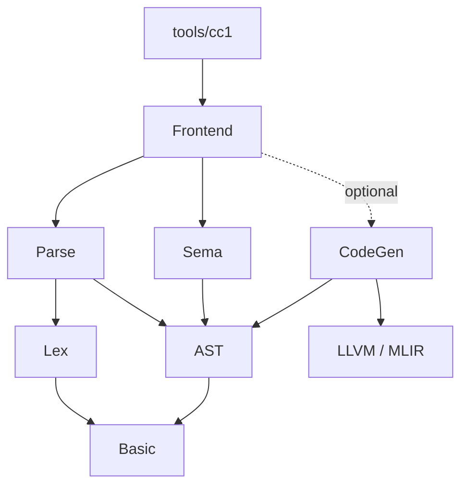

# Compiler architecture

The compiler keeps parsing, semantic analysis and code generation as separate
passes. Public headers live under `include/cc1/<component>`; implementation files
live under `lib/<component>`. Project includes always use the `cc1/` prefix.

| Component | CMake target | Responsibility |
| --- | --- | --- |
| Basic | `cc1_basic` | Source buffers and locations, diagnostics, language options, target information |
| AST | `cc1_ast` | Nodes, types, ownership and AST printing |
| Lex | `cc1_lex` | Tokens, lexer, preprocessing and preprocessor expressions |
| Parse | `cc1_parse` | Syntax and construction of the untyped AST |
| Sema | `cc1_sema` | Names, type checks and explicit implicit conversions |
| CodeGen | `cc1_codegen` | Optional MLIR generation from the checked AST |
| Frontend | `cc1_frontend` | Invocation options and execution of the compiler pipeline |

## Dependencies

Arrows point from a component to the components it uses:

AST does not include lexer or parser headers. Sema depends on AST, not Parse.
CodeGen also depends on AST, not Sema: it requires a successfully checked tree,
but does not keep an analyzer alive. LLVM/MLIR headers stay in CodeGen and the
optional implementation of Frontend; CLI and core public headers do not require
them.

## AST ownership

`ASTContext::create<T>()` allocates and owns every parser node and every implicit
conversion added by Sema. `ASTContext::getTypes()` exposes its owning `TypePool`.
Nodes and types use stable, non-owning pointers to refer to each other. Destroying
the context releases each allocation once, including allocations from a failed
parse. Node destructors run before types are released.

The context uses `unique_ptr` ownership so node destructors release their strings
and vectors. It is not a raw arena that skips destructors. No tree traversal or
recursive deletion is needed; shared references, declaration identities and
canonical declaration links do not change ownership.

Parser and Sema receive an `ASTContext&`. The `TranslationUnit*` returned by
`Parser::parse()` is borrowed from that context and must not be independently
deleted. Source buffers and their filename storage must also outlive AST use.

## Frontend

`CompilerInvocation` describes one input, one output action, language options,
include paths and an optional target. `parseCompilerInvocation()` translates CLI
arguments into that description and diagnoses conflicting actions.

`CompilerInstance` owns source buffers, diagnostics and ASTContext for one
invocation. `execute()` runs the selected stages and writes output and diagnostics
to caller-provided streams. Its retained AST can be inspected while the instance
remains alive; AST dumping stops before Sema, while normal checking and typed
dumping run semantic analysis. The executable only parses options and runs the
instance.

## Implementation boundaries

Parse is split into parser mechanics, declarations, expressions and statements.
Sema is split into declarations, expressions, statements and conversions.
CodeGen is split into module declarations, types, functions, expressions,
statements and storage. Scalar storage allocation, address lookup, loads and
stores share helpers in `MLIRGenMemory.cpp`; integer parameters stay in SSA form
until mutation or control flow requires storage.

Tests live under `Tests/Basic`, `Tests/AST`, `Tests/Lex`, `Tests/Parse`,
`Tests/Sema`, `Tests/CodeGen` and `Tests/Frontend`. CLI fixtures and expected dumps
retain their existing paths. AST tests cover destruction and conversions that
outlive Parser/Sema; frontend tests cover retained ASTs and stream output;
CodeGen tests cover parameter storage across nested control flow.

When changing a boundary, validate builds with `CC1_ENABLE_MLIR=OFF` and `ON`.
Ownership changes should also be checked with AddressSanitizer and
UndefinedBehaviorSanitizer on the core build.
