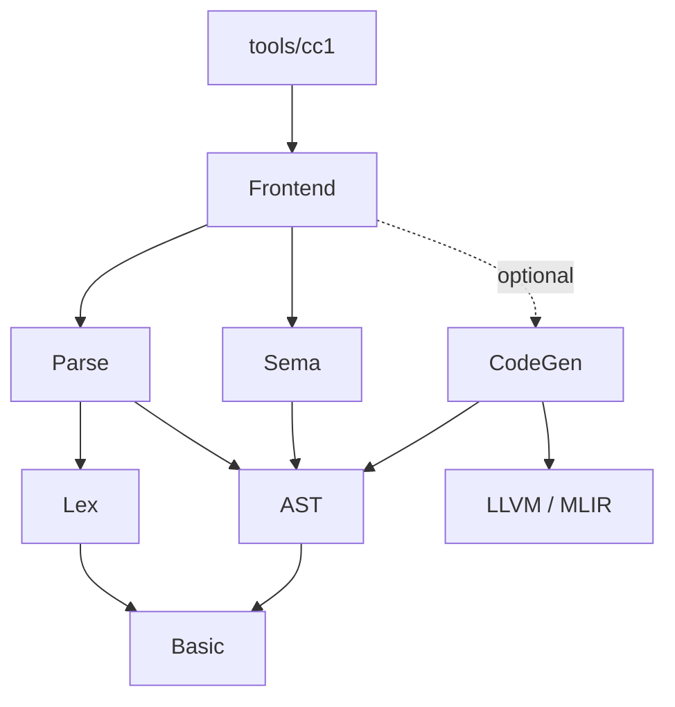

# Compiler architecture

The compiler keeps parsing, semantic analysis and code generation as separate
passes. C frontend headers live under `include/cc1/<component>`; implementation
files live under `lib/<component>`. Frontend includes use the `cc1/` prefix.

| Component | CMake target | Responsibility |
| --- | --- | --- |
| Basic | `cc1_basic` | Source buffers and locations, diagnostics, language options, target information |
| AST | `cc1_ast` | Nodes, types, ownership and AST printing |
| Lex | `cc1_lex` | Tokens, lexer, preprocessing and preprocessor expressions |
| Parse | `cc1_parse` | Syntax and construction of the untyped AST |
| Sema | `cc1_sema` | Names, type checks and explicit implicit conversions |
| CodeGen | `cc1_codegen` | Optional MLIR generation from the checked AST |
| Frontend | `cc1_frontend` | Invocation options and execution of the compiler pipeline |

## Dependencies

Arrows point from a component to the components it uses:

AST does not include lexer or parser headers. Sema depends on AST, not Parse.
CodeGen also depends on AST, not Sema: it requires a successfully checked tree,
but does not keep an analyzer alive. LLVM/MLIR headers stay in CodeGen and the
optional implementation of Frontend; CLI and core public headers do not require
them.

## AST ownership

`ASTContext::create<T>()` allocates and owns every parser node and every implicit
conversion added by Sema. `ASTContext::getTypes()` exposes its owning `TypePool`.
Nodes and types use stable, non-owning pointers to refer to each other. Destroying
the context releases each allocation once, including allocations from a failed
parse. Node destructors run before types are released.

The context uses `unique_ptr` ownership so node destructors release their strings
and vectors. It is not a raw arena that skips destructors. No tree traversal or
recursive deletion is needed; shared references, declaration identities and
canonical declaration links do not change ownership.

Parser and Sema receive an `ASTContext&`. The `TranslationUnit*` returned by
`Parser::parse()` is borrowed from that context and must not be independently
deleted. Source buffers and their filename storage must also outlive AST use.

## Frontend

`CompilerInvocation` describes one input, one output action, language options,
include paths and an optional target. `parseCompilerInvocation()` translates CLI
arguments into that description and diagnoses conflicting actions.

`CompilerInstance` owns source buffers, diagnostics and ASTContext for one
invocation. `execute()` runs the selected stages and writes output and diagnostics
to caller-provided streams. Its retained AST can be inspected while the instance
remains alive; AST dumping stops before Sema, while normal checking and typed
dumping run semantic analysis. The executable only parses options and runs the
instance.

## Implementation boundaries

Parse is split into parser mechanics, declarations, expressions and statements.
Sema is split into declarations, expressions, statements and conversions.
CodeGen is split into module declarations, types, functions, expressions,
statements and storage. Scalar storage allocation, address lookup, loads and
stores share helpers in `MLIRGenMemory.cpp`. `LocalStorageAnalysis` inspects the
checked AST before each function is emitted and records writes, address-taking
and self-references in initializers. This analysis belongs to CodeGen and has no
LLVM/MLIR dependency of its own; it does not retain or invoke Sema.

`MLIRGen` keeps the per-function analysis and two declaration-keyed maps:

- `values` holds SSA bindings for eligible scalar parameters and initialized
  automatic locals.
- `storage` holds `Address` bindings for modified or address-observable objects,
  uninitialized locals and fixed-size arrays.

Declaration identity distinguishes shadowed variables. Read-only SSA bindings
remain valid across CFG branches and loops; encountering control flow no longer
spills all parameters. Mutable objects continue to use memory rather than
requiring general SSA joins at this stage.

`createObjectStorage(FuncOp, Type, const Type&)` inserts fixed-size allocations
at the start of the function entry block and restores the caller's insertion
point with `OpBuilder::InsertionGuard`. Parameter stores execute at function
entry. Local initializer expressions and stores execute at the declaration's
control-flow position. This prevents repeated stack allocation in loops while
preserving repeated initialization and its side effects. Explicit lexical
lifetime operations and variable-length stack allocation remain future work.

Tests live under `Tests/Basic`, `Tests/AST`, `Tests/Lex`, `Tests/Parse`,
`Tests/Sema`, `Tests/CodeGen` and `Tests/Frontend`. CLI fixtures and expected dumps
retain their existing paths. AST tests cover destruction and conversions that
outlive Parser/Sema; frontend tests cover retained ASTs and stream output;
CodeGen tests cover SSA bindings, parameter storage, declaration shadowing,
entry-block allocations and initializer placement across nested control flow.
The real C fixtures and raw-IR/native checks are described in
[the SSA test guide](../Tests/CodeGen/SSA/README.md).

The reusable MLIR backend has a separate `include/tensorium` and `lib/tensorium`
boundary. CodeGen emits Tensorium pointers and memory operations; `tensorium-opt`
can convert scalar storage to MemRef independently of the C frontend. See
[Tensorium MLIR backend architecture](mlir_backend.md) for implemented dialect
and conversion components and the planned protection pipeline and runtime.

When changing a boundary, validate builds with `CC1_ENABLE_MLIR=OFF` and `ON`.
Ownership changes should also be checked with AddressSanitizer and
UndefinedBehaviorSanitizer on the core build.
